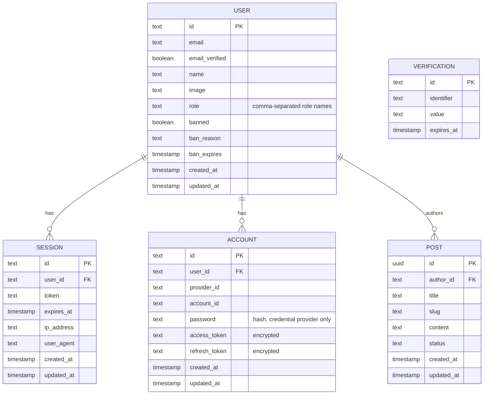

# DATABASE.md

Two databases with separate jobs:

| Database | Holds | Access |
|:---|:---|:---|
| **PostgreSQL 17** | App data: Better Auth tables, module tables | **Drizzle ORM** (`packages/db`), migrations with **Drizzle Kit** |
| **MongoDB 8** | Logs only: the `log_event` collection | Official `mongodb` driver in `apps/api/src/utils/mongo` (Drizzle does not support MongoDB) |

## 1. PostgreSQL principles

- Schema in `packages/db/src/schema/`, written with Drizzle (`pgTable`). Every app-data query goes through Drizzle; no raw SQL in modules except inside Drizzle's `sql` template where needed.
- Better Auth owns its tables (`user`, `session`, `account`, `verification`). Their schema is **generated**, never hand-written: `bun run auth:generate` (repo root), which runs `auth generate --config apps/api/src/utils/auth/auth.ts --output packages/db/src/schema/auth.ts -y` from `packages/db` (flags checked against `auth` 1.7.15, TASK-03). The CLI is the `auth` package, pinned as a dev dependency of `packages/db` at the same version as `better-auth`, so do not use `bunx auth@latest`. `-y` is needed because the CLI asks before overwriting; review the result with `git diff`. Re-run it whenever a Better Auth plugin or schema option is added or changed, then `bun run db:generate` and `bun run db:migrate`. Re-running it on unchanged options reproduces the file byte for byte (checked in TASK-03).
- **No `role` table** (DEC-022). `user.role` is a plain string.
- Module tables (`post`) reference `user.id`.
- Driver: `postgres` (postgres-js) through `drizzle-orm/postgres-js` (TASK-03). `createDb(url, options?)` in `packages/db/src/client.ts` opens a pool lazily and takes the URL as an argument, because only the app reads the environment (api R41); `options` are postgres-js options, the driver defaults when absent (added in TASK-04 for the one-connection client of the user mutation lock). The owner closes it with `db.$client.end()`.
- Scripts, all runnable from the repo root and all reading the root `.env` ([ARCHITECTURE.md §7](ARCHITECTURE.md)) (TASK-03): `bun run db:generate` (SQL migration from the schema), `bun run db:migrate`, `bun run db:seed`, `bun run auth:generate`. Migrations are in `packages/db/migrations/`; the first one is `0000_init`.
- Migrations are idempotent: running `drizzle-kit migrate` twice is a no-op (drizzle-kit records applied migrations in `drizzle.__drizzle_migrations`; the Postgres NOTICEs it prints on the second run are harmless). `drizzle-kit push` is for local experiments only, never for shared databases.
- IDs: Better Auth's default string IDs for its tables; `uuid` for module tables.

## 2. ERD (PostgreSQL)



The ERD shows the columns we use. The generated schema is authoritative for Better Auth tables, including plugin columns we do not use (DEC-032).

## 3. Better Auth tables

| Table | Key points |
|:---|:---|
| `user` | `email` unique. Admin plugin adds `role`, `banned`, `ban_reason`, `ban_expires`. `role` is **not** a foreign key. Generated as `role text` **nullable with no database default**: the `'user'` default (`defaultRole`) is applied by Better Auth when it creates the row, so a row inserted any other way has `role` NULL (TASK-03). `banned` is `boolean default false`, also nullable. |
| `session` | `token` unique; `user_id` → `user.id` on delete cascade. Stored in PostgreSQL only: the Redis secondary storage drops session entries, so this table alone decides whether a session exists (DEC-054, Proposed) (TASK-04). The admin plugin adds `impersonated_by`, which stays unused (DEC-032). |
| `account` | One row per sign-in method: `credential` (password hash) or `google`. OAuth tokens encrypted (`encryptOAuthTokens`). Also has `id_token`, `scope` and the two token expiry timestamps. **No unique constraint on (`provider_id`, `account_id`)**: the generator does not create one, and Better Auth looks the pair up before inserting (TASK-03). |
| `verification` | Email verification and password reset tokens. |

Generated column types (TASK-03): the Better Auth tables use `timestamp` **without** time zone (Drizzle reads and writes them as UTC), unlike `post`, which uses `timestamptz`. Every Better Auth table has `created_at` and `updated_at`.

Indexes the generator creates (TASK-03), so none has to be added by hand: `session_userId_idx` on `session(user_id)`, `account_userId_idx` on `account(user_id)` and `verification_identifier_idx` on `verification(identifier)`. The unique constraints are `user_email_unique` and `session_token_unique`.

## 4. `post`

| Column | Type | Constraint | Notes |
|:---|:---|:---|:---|
| `id` | `uuid` | PK, default `gen_random_uuid()` | |
| `author_id` | `text` | NOT NULL, FK → `user.id` ON DELETE CASCADE | Ownership rule |
| `title` | `text` | NOT NULL | 3–`POSTS_TITLE_MAX_LENGTH` chars (validated in `model.ts`; the number is `TBD`, set per deployment, TASK-08) |
| `slug` | `text` | NOT NULL, UNIQUE | Generated by the service |
| `content` | `text` | NOT NULL | 10–`POSTS_CONTENT_MAX_LENGTH` chars (same, TASK-08) |
| `status` | `text` | NOT NULL, default `'draft'`, CHECK in (`draft`, `published`) | |
| `created_at` | `timestamptz` | NOT NULL, default `now()` | |
| `updated_at` | `timestamptz` | NOT NULL, default `now()` | Set by the service on update |

Indexes: `idx_post_author (author_id)`, `idx_post_status_created (status, created_at desc)`, unique `slug`.

Built as in the sketch below (TASK-03). Names in the database: `post_slug_unique`, `post_status_check`, `post_author_id_user_id_fk`. Drizzle writes the descending column as `created_at DESC NULLS LAST`, which is the same order as plain `DESC` because `created_at` is `NOT NULL`. The `TBD` length limits are not enforced in the table.

```ts
// packages/db/src/schema/post.ts
export const post = pgTable('post', {
  id:        uuid('id').primaryKey().defaultRandom(),
  authorId:  text('author_id').notNull().references(() => user.id, { onDelete: 'cascade' }),
  title:     text('title').notNull(),
  slug:      text('slug').notNull().unique(),
  content:   text('content').notNull(),
  status:    text('status', { enum: ['draft', 'published'] }).notNull().default('draft'),
  createdAt: timestamp('created_at', { withTimezone: true }).notNull().defaultNow(),
  updatedAt: timestamp('updated_at', { withTimezone: true }).notNull().defaultNow(),
}, (t) => [
  index('idx_post_author').on(t.authorId),
  index('idx_post_status_created').on(t.status, t.createdAt.desc()),
  check('post_status_check', sql`${t.status} in ('draft', 'published')`),
])
```

## 5. Design-only PostgreSQL tables

| Table | Spec | Built when |
|:---|:---|:---|
| `feature_flag` | [feature-flags/database-provider.md §2](feature-flags/database-provider.md) | Feature flags adopted. Global at every stage, never `organization_id` (DEC-048) |
| `organization`, `member`, `invitation`, `organization_role`, `session.active_organization_id`, `organization_id` on every module table | [auth/access/single-org.md §3, §5](auth/access/single-org.md) | Access stage 2 is chosen (DEC-042, DEC-044, DEC-047) |
| Row-level security policies on module tables, database roles `app_owner` / `app_runtime` / `app_platform` | [saas/architecture.md §4](../../specs/eng/saas/architecture.md) | SaaS multi-tenant, Step B release B1 (DEC-051) |
| `access_migration_backup` (temporary) | [auth/access/migration.md, Appendix A](auth/access/migration.md) | Step A: stage 1 → stage 2 |

## 6. Seed (dev only)

- One `super_admin` from `SEED_SUPER_ADMIN_EMAIL` / `SEED_SUPER_ADMIN_PASSWORD`, created through Better Auth's API (so the password is hashed by Better Auth), then promoted by setting `role`.
- A few `post` rows owned by that user.
- Idempotent. Refuses to run when `NODE_ENV=production`.

Built as `bun run db:seed` (`packages/db/src/seed.ts`, TASK-03):

- **Guard first.** It checks `NODE_ENV` before reading any other variable or opening a connection, whether the value comes from the shell or from `.env`.
- **Both seed variables are required**; the password has no default. Better Auth enforces its own password policy.
- **Account.** Created with `auth.api.signUpEmail` (name `Super Admin`, email lower-cased as Better Auth stores it, `autoSignIn: false` so no session row is left behind), then `user.role` is set to `super_admin`. If a user with that email already exists with another role, it is promoted instead of duplicated; if it is already `super_admin`, nothing changes.
- **Posts.** Three examples (two `published`, one `draft`) with fixed slugs, inserted with `ON CONFLICT (slug) DO NOTHING`, so a second run adds none. Titles and contents meet the minimum lengths (3 and 10 characters); the `TBD` maximums are not applied.
- **Own Better Auth instance.** `packages/db` cannot import `packages/auth` (dependency direction, [ARCHITECTURE.md §2](ARCHITECTURE.md)), so the seed builds a minimal one (Drizzle adapter, email and password, admin plugin) with Better Auth's default password hashing. If `packages/auth` ever overrides the hashing options, mirror them in the seed.

## 7. Data rules

| Rule | Where enforced |
|:---|:---|
| Deleting a user deletes their sessions, accounts and posts | FK cascade |
| `user.role` contains only registry roles | `hooks.before` on set-role; startup `rbac.unknown_role` warning |
| Only the author, or a holder of `posts:manage_all`, changes a post | `PostService` |
| Post list cache invalidated on every post write, and when a user removal deletes posts by cascade (TASK-08) | `PostService` |

`TBD`: the post `title`/`content` max length numbers (configured per deployment through `POSTS_TITLE_MAX_LENGTH` / `POSTS_CONTENT_MAX_LENGTH`, required, no default; TASK-08), cleanup policy for expired `session` and `verification` rows. `POSTS_CACHE_TTL` defaults to 60 seconds (TASK-08).

## 8. MongoDB log store

Separate database (`LOG_MONGO_DB`, default `app_logs`), separate credentials, never shared with app data. Full design, write path and retention in [observability/log-storage.md](observability/log-storage.md).

**Collection `log_event`**: one document per telemetry event, the same fields as the stdout line ([observability/README.md §5](observability/README.md)), with `time` stored as a BSON `Date`.

| Index | Used by |
|:---|:---|
| `{ kind: 1, time: 1 }` | Prune command; time-range queries per kind |
| `{ module: 1, level: 1, time: -1 }` | "Errors in module X" |
| `{ requestId: 1 }` (sparse) | Every line of one request |
| `{ userId: 1, time: -1 }` (sparse) | Audit lookups and erasure requests |
| `{ event: 1, time: -1 }` | One event type over time |

Indexes are created by `bun run logs:setup` (idempotent, `createIndexes`), not at API startup. No TTL index: deletion is manual (DEC-034).
