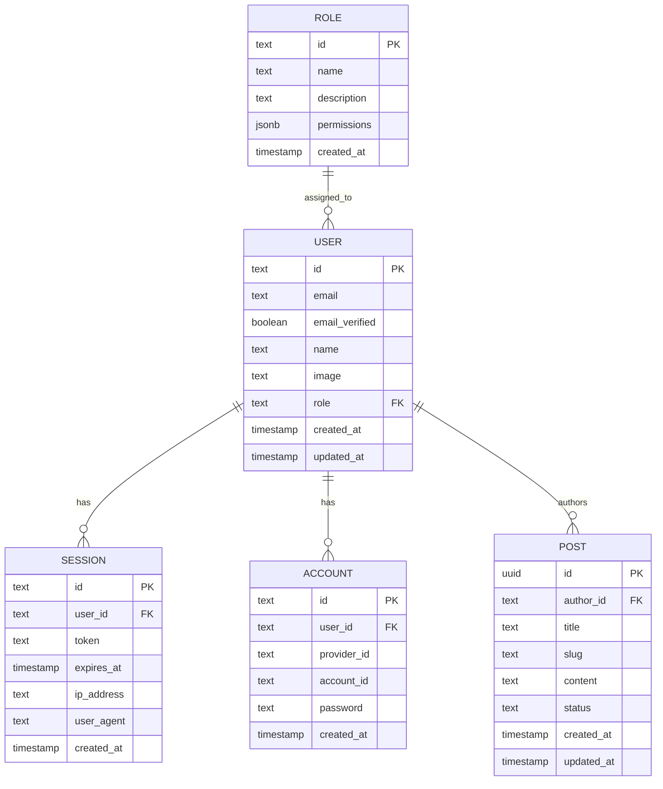

# DATABASE.md: BunForge

## 1. Prinsip Skema Data

BunForge menggunakan PostgreSQL 17 + Drizzle ORM 0.36+ (PRD §6). Skema didefinisikan di `packages/db/src/schema/` dan di-migrasikan via Drizzle Kit. **Better Auth admin plugin adalah sumber kebenaran tunggal untuk role & permission** (DEC-005), sehingga tabel `user`, `session`, `account`, dan `role` mengikuti skema resmi Better Auth dan tidak boleh diduplikasi. Modul bisnis (contoh: `posts`) mereferensikan `user.id` sebagai FK.

Karena target dokumentasi ini adalah **5 tabel inti maksimum**, tabel pendukung Better Auth (`session`, `account`, `verification`) diringkas pada §3 dan tidak dijabarkan penuh; implementasi mengikuti generator `better-auth` CLI.

## 2. ERD



## 3. Definisi Tabel Inti

### 3.1 `user`

| Kolom | Tipe | Constraint | Keterangan |
|:---|:---|:---|:---|
| `id` | `text` | PK | Dibuat Better Auth (nanoid) |
| `email` | `text` | NOT NULL, UNIQUE | Login email/password (DEC-004) |
| `email_verified` | `boolean` | NOT NULL DEFAULT false | Status verifikasi email |
| `name` | `text` | NOT NULL | Nama tampilan |
| `image` | `text` | NULL | URL avatar (OAuth Google) |
| `role` | `text` | FK → `role.name`, DEFAULT `'user'` | Role aktif (DEC-005) |
| `created_at` | `timestamp` | NOT NULL DEFAULT now() | — |
| `updated_at` | `timestamp` | NOT NULL DEFAULT now() | — |

**Index:** `idx_user_role` pada `role`; `idx_user_email` (unique sudah mencakup).

### 3.2 `role`

| Kolom | Tipe | Constraint | Keterangan |
|:---|:---|:---|:---|
| `id` | `text` | PK | — |
| `name` | `text` | NOT NULL, UNIQUE | `super_admin`, `admin`, `user` |
| `description` | `text` | NULL | Deskripsi role |
| `permissions` | `jsonb` | NOT NULL DEFAULT `'[]'` | Array permission `resource:action` |
| `created_at` | `timestamp` | NOT NULL DEFAULT now() | — |

**Index:** `idx_role_name` (unique). Seed awal: `super_admin` dengan `["*"]`, `admin` dengan `["users:read","posts:write"]`, `user` dengan `["posts:read","posts:write:own"]`.

### 3.3 `session`

Mengikuti skema Better Auth. Kolom kunci: `id` (PK), `user_id` (FK → `user.id`, ON DELETE CASCADE), `token` (UNIQUE), `expires_at`, `ip_address`, `user_agent`, `created_at`. **Index:** `idx_session_user`, `idx_session_token`.

### 3.4 `account`

Mengikuti skema Better Auth. Kolom kunci: `id` (PK), `user_id` (FK), `provider_id` (`credential`/`google`), `account_id`, `password` (hash — hanya untuk `credential`), `created_at`. **Index:** `idx_account_user`, `uniq_account_provider` UNIQUE(`provider_id`, `account_id`).

### 3.5 `post`

| Kolom | Tipe | Constraint | Keterangan |
|:---|:---|:---|:---|
| `id` | `uuid` | PK DEFAULT gen_random_uuid() | — |
| `author_id` | `text` | FK → `user.id`, ON DELETE CASCADE | Pemilik data (FR-11) |
| `title` | `text` | NOT NULL | — |
| `slug` | `text` | NOT NULL, UNIQUE | Cache key Redis (DEC-001) |
| `content` | `text` | NOT NULL | — |
| `status` | `text` | NOT NULL DEFAULT `'draft'` | `draft` / `published` |
| `created_at` | `timestamp` | NOT NULL DEFAULT now() | — |
| `updated_at` | `timestamp` | NOT NULL DEFAULT now() | — |

**Index:** `idx_post_author` pada `author_id`; `idx_post_status` pada `status`; `idx_post_slug` (unique).

## 4. Skema Drizzle (Referensi `packages/db`)

> Catatan: PRD memilih **Drizzle ORM**, bukan Prisma. Skema ditulis dalam Drizzle; ekuivalen Prisma disertakan sebagai lampiran opsional untuk generator kode.

```typescript
// packages/db/src/schema/index.ts
import { pgTable, text, boolean, timestamp, uuid, jsonb, index, uniqueIndex } from "drizzle-orm/pg-core";

export const role = pgTable("role", {
  id: text("id").primaryKey(),
  name: text("name").notNull().unique(),
  description: text("description"),
  permissions: jsonb("permissions").$type<string[]>().notNull().default([]),
  createdAt: timestamp("created_at").notNull().defaultNow(),
});

export const user = pgTable("user", {
  id: text("id").primaryKey(),
  email: text("email").notNull().unique(),
  emailVerified: boolean("email_verified").notNull().default(false),
  name: text("name").notNull(),
  image: text("image"),
  role: text("role").notNull().default("user").references(() => role.name),
  createdAt: timestamp("created_at").notNull().defaultNow(),
  updatedAt: timestamp("updated_at").notNull().defaultNow(),
}, (t) => ({ roleIdx: index("idx_user_role").on(t.role) }));

export const session = pgTable("session", {
  id: text("id").primaryKey(),
  userId: text("user_id").notNull().references(() => user.id, { onDelete: "cascade" }),
  token: text("token").notNull().unique(),
  expiresAt: timestamp("expires_at").notNull(),
  ipAddress: text("ip_address"),
  userAgent: text("user_agent"),
  createdAt: timestamp("created_at").notNull().defaultNow(),
}, (t) => ({ userIdx: index("idx_session_user").on(t.userId) }));

export const account = pgTable("account", {
  id: text("id").primaryKey(),
  userId: text("user_id").notNull().references(() => user.id, { onDelete: "cascade" }),
  providerId: text("provider_id").notNull(),
  accountId: text("account_id").notNull(),
  password: text("password"),
  createdAt: timestamp("created_at").notNull().defaultNow(),
}, (t) => ({
  userIdx: index("idx_account_user").on(t.userId),
  providerUniq: uniqueIndex("uniq_account_provider").on(t.providerId, t.accountId),
}));

export const post = pgTable("post", {
  id: uuid("id").primaryKey().defaultRandom(),
  authorId: text("author_id").notNull().references(() => user.id, { onDelete: "cascade" }),
  title: text("title").notNull(),
  slug: text("slug").notNull().unique(),
  content: text("content").notNull(),
  status: text("status").notNull().default("draft"),
  createdAt: timestamp("created_at").notNull().defaultNow(),
  updatedAt: timestamp("updated_at").notNull().defaultNow(),
}, (t) => ({
  authorIdx: index("idx_post_author").on(t.authorId),
  statusIdx: index("idx_post_status").on(t.status),
}));
```

**Catatan integrasi Better Auth:** `drizzleAdapter` di `packages/auth` menerima schema di atas; kolom `role` pada `user` diisi otomatis oleh admin plugin saat assign/unassign role. Tabel `verification` (reset password/email) tetap dibuat oleh generator Better Auth dan di luar cakupan 5 tabel inti.

## 5. Aturan Bisnis Data

| Aturan | Sumber |
|:---|:---|
| Setiap `post.author_id` wajib menunjuk user aktif; hapus user → cascade hapus post | FR-11 |
| Permission disimpan sebagai array `resource:action` di `role.permissions`; middleware default deny | DEC-005, PRD §5 |
| Seed dev: 1 user Super Admin + 3 role default | FR-08 |
| Cache key `post:{slug}` TTL TBD detik; invalidasi pada update/delete | DEC-001 |
| Migrasi idempotent via `drizzle-kit migrate`; rollback manual | PRD §5 |

Nilai TTL cache, batas panjang `title`/`content`, dan kebijakan retensi `session` ditandai **TBD** hingga baseline MVP diukur.