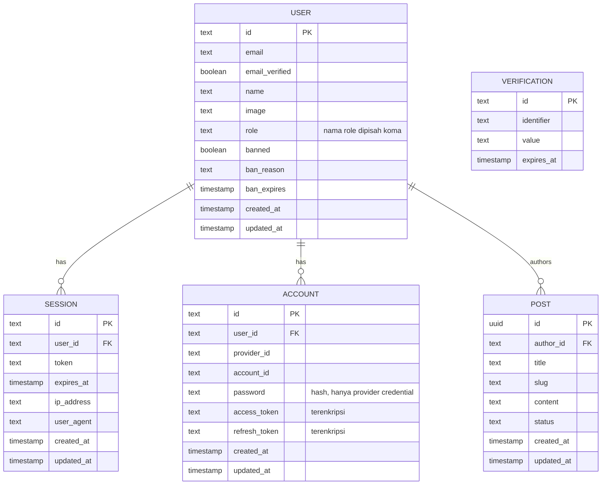

# DATABASE.md

Dua database dengan tugas berbeda:

| Database | Isi | Akses |
|:---|:---|:---|
| **PostgreSQL 17** | Data aplikasi: tabel Better Auth, tabel modul | **Drizzle ORM** (`packages/db`), migrasi dengan **Drizzle Kit** |
| **MongoDB 8** | Hanya log: koleksi `log_event` | Driver resmi `mongodb` di `apps/api/src/utils/mongo` (Drizzle tidak mendukung MongoDB) |

## 1. Prinsip PostgreSQL

- Skema di `packages/db/src/schema/`, ditulis dengan Drizzle (`pgTable`). Setiap query data aplikasi lewat Drizzle; tidak ada SQL mentah di modul kecuali di dalam template `sql` Drizzle bila perlu.
- Better Auth memiliki tabelnya sendiri (`user`, `session`, `account`, `verification`). Skemanya **di-generate**, tidak pernah ditulis tangan: `bunx auth@latest generate --config apps/api/src/utils/auth/auth.ts --output packages/db/src/schema/auth.ts` (*verify* flag CLI). Jalankan ulang setiap kali plugin Better Auth ditambah atau diubah, lalu `drizzle-kit generate` dan `drizzle-kit migrate`.
- **Tanpa tabel `role`** (DEC-022). `user.role` adalah string biasa.
- Tabel modul (`post`) mereferensikan `user.id`.
- Migrasi idempoten: menjalankan `drizzle-kit migrate` dua kali tidak mengubah apa pun. `drizzle-kit push` hanya untuk eksperimen lokal, tidak pernah untuk database bersama.
- ID: string ID default Better Auth untuk tabelnya; `uuid` untuk tabel modul.

## 2. ERD (PostgreSQL)



ERD menampilkan kolom yang kita pakai. Skema hasil generate adalah acuan untuk tabel Better Auth, termasuk kolom plugin yang tidak kita pakai (DEC-032).

## 3. Tabel Better Auth

| Tabel | Poin penting |
|:---|:---|
| `user` | `email` unik. Admin plugin menambah `role` (default `'user'`), `banned`, `ban_reason`, `ban_expires`. `role` **bukan** foreign key. |
| `session` | `token` unik; `user_id` → `user.id` on delete cascade. Disimpan di PostgreSQL **dan** Redis (DEC-019). |
| `account` | Satu baris per metode sign-in: `credential` (hash password) atau `google`. Token OAuth terenkripsi (`encryptOAuthTokens`). Unik (`provider_id`, `account_id`). |
| `verification` | Token verifikasi email dan reset password. |

Index tambahan bila generator tidak membuatnya: `session(user_id)`, `account(user_id)` (*verify* setelah generate).

## 4. `post`

| Kolom | Tipe | Constraint | Catatan |
|:---|:---|:---|:---|
| `id` | `uuid` | PK, default `gen_random_uuid()` | |
| `author_id` | `text` | NOT NULL, FK → `user.id` ON DELETE CASCADE | Aturan kepemilikan |
| `title` | `text` | NOT NULL | 3–`TBD` karakter (divalidasi di `model.ts`) |
| `slug` | `text` | NOT NULL, UNIQUE | Dibuat oleh service |
| `content` | `text` | NOT NULL | 10–`TBD` karakter |
| `status` | `text` | NOT NULL, default `'draft'`, CHECK in (`draft`, `published`) | |
| `created_at` | `timestamptz` | NOT NULL, default `now()` | |
| `updated_at` | `timestamptz` | NOT NULL, default `now()` | Diisi service saat update |

Index: `idx_post_author (author_id)`, `idx_post_status_created (status, created_at desc)`, `slug` unik.

```ts
// packages/db/src/schema/post.ts (sketsa)
export const post = pgTable('post', {
  id:        uuid('id').primaryKey().defaultRandom(),
  authorId:  text('author_id').notNull().references(() => user.id, { onDelete: 'cascade' }),
  title:     text('title').notNull(),
  slug:      text('slug').notNull().unique(),
  content:   text('content').notNull(),
  status:    text('status', { enum: ['draft', 'published'] }).notNull().default('draft'),
  createdAt: timestamp('created_at', { withTimezone: true }).notNull().defaultNow(),
  updatedAt: timestamp('updated_at', { withTimezone: true }).notNull().defaultNow(),
}, (t) => [
  index('idx_post_author').on(t.authorId),
  index('idx_post_status_created').on(t.status, t.createdAt.desc()),
])
```

## 5. Tabel PostgreSQL yang masih desain

| Tabel | Spec | Dibuat saat |
|:---|:---|:---|
| `feature_flag` | [feature-flags/database-provider.md §2](feature-flags/database-provider.md) | Feature flag diadopsi. Global di setiap tahap, tidak pernah punya `organization_id` (DEC-048) |
| `organization`, `member`, `invitation`, `organization_role`, `session.active_organization_id`, `organization_id` di setiap tabel modul | [auth/access/single-org.md §3, §5](auth/access/single-org.md) | Access stage 2 dipilih (DEC-042, DEC-044, DEC-047) |
| Policy row-level security di tabel modul, role database `app_owner` / `app_runtime` / `app_platform` | [saas/architecture.md §4](saas/architecture.md) | SaaS multi-tenant, rilis B1 Langkah B (DEC-051) |
| `access_migration_backup` (sementara) | [auth/access/migration.md, Lampiran A](auth/access/migration.md) | Langkah A: tahap 1 → tahap 2 |

## 6. Seed (hanya dev)

- Satu `super_admin` dari `SEED_SUPER_ADMIN_EMAIL` / `SEED_SUPER_ADMIN_PASSWORD`, dibuat lewat API Better Auth (agar password di-hash oleh Better Auth), lalu dinaikkan dengan mengisi `role`.
- Beberapa baris `post` milik user itu.
- Idempoten. Menolak berjalan bila `NODE_ENV=production`.

## 7. Aturan data

| Aturan | Ditegakkan di |
|:---|:---|
| Menghapus user menghapus sesi, akun, dan post-nya | FK cascade |
| `user.role` hanya berisi role registry | `hooks.before` pada set-role; peringatan `rbac.unknown_role` saat startup |
| Hanya penulis, atau pemegang `posts:manage_all`, yang mengubah post | `PostService` |
| Cache daftar post diinvalidasi setiap kali post ditulis | `PostService` |

`TBD`: panjang maksimum `title`/`content` post, `POSTS_CACHE_TTL`, kebijakan pembersihan baris `session` dan `verification` yang kedaluwarsa.

## 8. Log store MongoDB

Database terpisah (`LOG_MONGO_DB`, default `app_logs`), kredensial terpisah, tidak pernah dipakai bersama data aplikasi. Desain lengkap, jalur tulis, dan retensi di [observability/log-storage.md](observability/log-storage.md).

**Koleksi `log_event`**: satu dokumen per telemetry event, dengan field yang sama seperti baris stdout ([observability/README.md §5](observability/README.md)), dengan `time` disimpan sebagai BSON `Date`.

| Index | Dipakai oleh |
|:---|:---|
| `{ kind: 1, time: 1 }` | Perintah prune; query rentang waktu per kind |
| `{ module: 1, level: 1, time: -1 }` | "Error di modul X" |
| `{ requestId: 1 }` (sparse) | Semua baris dari satu request |
| `{ userId: 1, time: -1 }` (sparse) | Pencarian audit dan permintaan penghapusan data |
| `{ event: 1, time: -1 }` | Satu jenis event dari waktu ke waktu |

Index dibuat oleh `bun run logs:setup` (idempoten, `createIndexes`), bukan saat API startup. Tanpa TTL index: penghapusan dilakukan manual (DEC-034).
